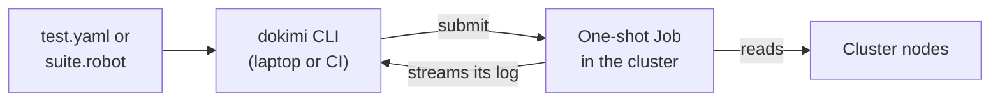

# How it works

## A run is a one-shot Job

You run the `dokimi` CLI on your machine or in CI. It validates your test definition, renders
the Kubernetes objects a run needs, and submits them. From then on, the run happens **inside the
cluster**, as a one-shot Kubernetes Job, and the CLI streams its log back to you.



Three properties follow from this, and they are the point of the design:

- **Nothing is permanently installed.** A Job is not a controller. Once it exits, the cluster is
  as it was.
- **The run does not depend on your connection.** The Job is a server-side resource. If the CLI
  disconnects, the run carries on, and `dokimi attach <run-id>` resumes streaming, from any
  machine with access to the cluster.
- **`--dry-run` never submits anything.** It renders the plan and the manifests, and stops.

## The phases of a run

A run moves through twelve phases, numbered 0 to 11. dokimi's messages refer to them by number,
so this table is also a key to what you see in the log.

| # | Phase | What happens | Status |
| --- | --- | --- | --- |
| 0 | Authoring | You write a YAML document or a Robot suite | <span class="dk-status dk-status--works">works today</span> |
| 1 | Submission | The CLI validates, renders the manifests, submits the Job, streams its log, and can reattach. `--dry-run` stops here | <span class="dk-status dk-status--works">works today</span> |
| 2 | Ingestion | In the Job, the definition is parsed and checked again | <span class="dk-status dk-status--works">works today</span> |
| 3 | Planning | The two nodes are resolved against the cluster, and the test is planned | <span class="dk-status dk-status--works">works today</span> |
| 4 | Preflight | The cluster is checked before any test runs: scheduling, pod-to-pod connectivity, DNS, image pull, Prometheus access | <span class="dk-status dk-status--planned">planned</span> |
| 5 | Suite rendering | The definition is rendered to the Robot suite that actually runs | <span class="dk-status dk-status--planned">planned</span> |
| 6 | Execution | Robot Framework runs the suite, which deploys the test pods and starts the traffic | <span class="dk-status dk-status--planned">planned</span> |
| 7 | Measurement | An exporter next to each test pod publishes the results as Prometheus metrics | <span class="dk-status dk-status--planned">planned</span> |
| 8 | Validation | The pass criteria are evaluated against the measurements. No data is never a pass | <span class="dk-status dk-status--planned">planned</span> |
| 9 | Reporting | Robot's own report, plus a CSV and JSONL result file | <span class="dk-status dk-status--planned">planned</span> |
| 10 | Diagnostics | Where the pods ran, and how healthy they were, captured while that evidence still exists | <span class="dk-status dk-status--planned">planned</span> |
| 11 | Cleanup and exit | The run's objects are deleted, or kept if the run failed, and the exit code goes back to you | <span class="dk-status dk-status--planned">planned</span> |

Today a run stops after phase 3 and says so:

```text
run 20260925-083457-9e7c31
phase 2 (ingestion): definition parsed
...
phase 3 (planning): 1 test, sequential
  pair-001  worker-01 -> worker-02
phases 4 to 11 are not implemented in this build: ... The run stops here without a verdict.
```

It exits with `5`, not `0`: a run that stops early must never look like a run that passed.

## Where Robot Framework fits

Robot Framework has two separate roles in dokimi.

- **As a parser**, today. A `.robot` test definition is read with Robot's own parsing API, so
  keywords are matched the way Robot matches them.
- **As the runner and reporter**, from the first release. The Job renders your definition to a
  Robot suite and runs it, and you get Robot's familiar `report.html` and `log.html`.

Robot Framework is **not** needed on your machine. The CLI works without it. It runs inside the
cluster, in the orchestrator image.

## What a run creates

A submission creates three objects in the test type's namespace, `dokimi-iperf2`:

| Object | What it is for |
| --- | --- |
| `run-<id>-owner` (ConfigMap) | The run's owner. Everything else the run creates points at it |
| `run-<id>-definition` (ConfigMap) | Your test definition, mounted into the Job, so the run never depends on a file on your disk |
| `run-<id>` (Job) | The run itself |

Every one of them is labelled `app.kubernetes.io/managed-by: dokimi` and `dokimi.io/run-id: <id>`.
[Runs and exit codes](concepts/runs.md) goes into the details.
