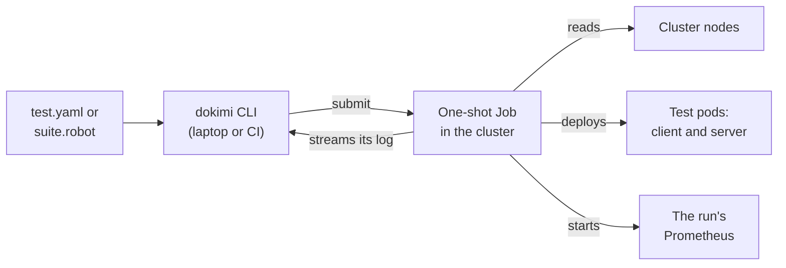

# How it works

## A run is a one-shot Job

You run the `dokimi` CLI on your machine or in CI. It validates your test definition, renders
the Kubernetes objects a run needs, and submits them. From then on, the run happens **inside the
cluster**, as a one-shot Kubernetes Job, and the CLI streams its log back to you.



Three properties follow from this, and they are the point of the design:

- **No controller is installed.** A Job is not a controller, and it ends with the run. What
  stays is the run's own Prometheus, kept on purpose so that the run's history outlives it,
  until you remove it.
- **The run does not depend on your connection.** The Job is a server-side resource. If the CLI
  disconnects, the run carries on, and `dokimi attach <run-id>` resumes streaming, from any
  machine with access to the cluster.
- **`--dry-run` never submits anything.** It renders the plan and the manifests, and stops.

## The phases of a run

A run moves through twelve phases, numbered 0 to 11. dokimi's messages refer to them by number,
so this table is also a key to what you see in the log.

| # | Phase | What happens | Status |
| --- | --- | --- | --- |
| 0 | Authoring | You write a YAML document or a Robot suite | <span class="dk-status dk-status--works">works today</span> |
| 1 | Submission | The CLI validates, renders the manifests, submits the Job, streams its log, and can reattach. `--dry-run` stops here | <span class="dk-status dk-status--works">works today</span> |
| 2 | Ingestion | In the Job, the definition is parsed and checked again | <span class="dk-status dk-status--works">works today</span> |
| 3 | Planning | The two nodes are resolved against the cluster, and the test is planned | <span class="dk-status dk-status--works">works today</span> |
| 4 | Preflight | The run claims the cluster, so only one run at a time measures its network. It starts its own Prometheus and checks that it answers queries. Then the cluster is checked before any test runs: scheduling, pod-to-pod connectivity, DNS, image pull | <span class="dk-status dk-status--works">claim and Prometheus work today</span> <span class="dk-status dk-status--planned">cluster checks planned</span> |
| 5 | Suite rendering | The definition is rendered to the Robot suite that actually runs | <span class="dk-status dk-status--works">works today</span> |
| 6 | Execution | Robot Framework runs the suite, which deploys the test pods, waits until both are ready, starts the traffic and waits for it to finish | <span class="dk-status dk-status--works">works today</span> |
| 7 | Measurement | An exporter next to each test pod publishes the results as Prometheus metrics | <span class="dk-status dk-status--planned">planned</span> |
| 8 | Validation | The pass criteria are evaluated against the measurements. No data is never a pass | <span class="dk-status dk-status--planned">planned</span> |
| 9 | Reporting | Robot's own report, which comes back to your machine, plus a CSV and JSONL result file | <span class="dk-status dk-status--works">Robot's report works today</span> <span class="dk-status dk-status--planned">CSV and JSONL planned</span> |
| 10 | Diagnostics | Where the pods ran, and how healthy they were, captured while that evidence still exists | <span class="dk-status dk-status--planned">planned</span> |
| 11 | Cleanup and exit | The run's objects are deleted, or kept if the run failed, and the exit code goes back to you | <span class="dk-status dk-status--works">test pods removed today</span> <span class="dk-status dk-status--planned">the rest planned</span> |

Today a run gets as far as phase 9's Robot report. It claims the cluster, starts its
Prometheus and checks that it answers, then runs the test through Robot Framework. Phases 7 and
8 are not there yet, so it ends without a verdict and says so:

```text
run 20261013-120000-a1b2c3
phase 2 (ingestion): definition parsed
...
phase 3 (planning): 1 test, sequential
  pair-001  worker-01 -> worker-02

phase 4 (preflight): cluster claimed for this run until 2026-10-13T12:20:30Z
phase 4 (preflight): monitoring mode managed (requested)
  Prometheus  http://run-20261013-120000-a1b2c3-prometheus.dokimi-iperf2.svc:9090
  node_exporter       deployed by this run (dokimi-iperf2/run-20261013-120000-a1b2c3-node-exporter)
  kube_state_metrics  absent
phase 4 (preflight): Prometheus answers queries
  ...
  kept after the run ...; remove it with: kubectl delete deployment,service,configmap ...
  query it from your machine with: kubectl port-forward -n dokimi-iperf2 service/run-20261013-120000-a1b2c3-prometheus 9090:9090
phase 4 (preflight): the cluster checks are not implemented in this build ...; the run continues without them

phase 5 (suite rendering): /work/artifacts/20261013-120000-a1b2c3/suite.robot
phase 6 (execution): pair-001  worker-01 -> worker-02, one Robot Framework process
...
phase 9a (reporting): /work/artifacts/20261013-120000-a1b2c3/log.html, .../report.html

the rest of phases 7 to 11 is not implemented in this build: ... The run stops here without a verdict; Robot's report says which steps ran.
phase 11 (cleanup): removed 2 test pod(s)
phase 11 (cleanup): removed node-exporter run-20261013-120000-a1b2c3-node-exporter
...
artifacts: results/20261013-120000-a1b2c3
```

It exits with `5`, not `0`: a run without a verdict must never look like a run that passed. On
the way out it removes its test pods and waits until they are gone, removes the node-exporter it
deployed, and then marks itself finished, so it stops holding the cluster at once.

## Where Robot Framework fits

Robot Framework has two separate roles in dokimi.

- **As a parser**, today. A `.robot` test definition is read with Robot's own parsing API, so
  keywords are matched the way Robot matches them.
- **As the runner and reporter**, today. The Job renders your definition to a Robot suite,
  the same one `dokimi convert` prints, and runs it with one Robot Framework process per pair of
  nodes. The suite's keywords call dokimi's Python library, which deploys the client and server
  pods, waits until both are ready, starts `iperf2` and waits for it to finish. Robot's `rebot`
  merges the reports, and you get Robot's familiar `report.html` and `log.html`.

The report comes back to your machine through the Job's log: `submit` and `attach` extract it
into the definition's results directory, under the run id:

```text
results/20261013-120000-a1b2c3/
  log.html       Robot Framework's log of the run
  report.html    its report
  output.xml     every pair's results, merged
  suite.robot    the suite that ran
  pairs/         one output.xml per pair
```

Until evaluating the pass criteria is built, every criterion keyword in that report **fails**
and says it was not checked. A test must never look as if it passed when nothing was compared.

Robot Framework is **not** needed on your machine. The CLI works without it. It runs inside the
cluster, in the orchestrator image.

## What a run creates

A submission creates three objects in the test type's namespace, `dokimi-iperf2`:

| Object | What it is for |
| --- | --- |
| `run-<id>-owner` (ConfigMap) | The run's owner. Everything else the run creates points at it, except its Prometheus |
| `run-<id>-definition` (ConfigMap) | Your test definition, mounted into the Job, so the run never depends on a file on your disk |
| `run-<id>` (Job) | The run itself |

In phase 4 the run adds its own Prometheus, `run-<id>-prometheus`: a ConfigMap, a Deployment
and a Service. Unlike everything else, it is kept after the run, so the run's history outlives
it. If the cluster runs no node-exporter, the run also deploys one, as a DaemonSet, and removes
it again when the run ends.

In phase 6 each test adds a client pod and a server pod. The run removes them before it frees
the cluster, however the run ends.

Every one of them is labelled `app.kubernetes.io/managed-by: dokimi` and `dokimi.io/run-id: <id>`.
[Runs and exit codes](concepts/runs.md) goes into the details.
